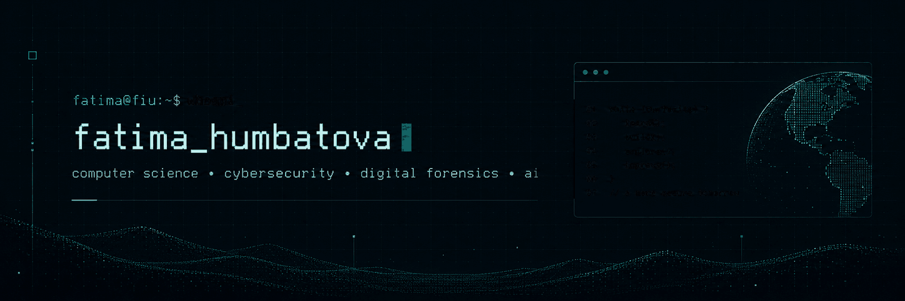

  

**B.S. Computer Science @ Florida International University · Class of 2027**

---

## `01 / about`

- B.S. Computer Science student at **Florida International University (FIU)**
- Interested in **cybersecurity**, **digital forensics**, **AI-assisted security**, and **software engineering**
- Building a stronger portfolio of practical, well-documented, research-aware software projects for graduate school applications
- Focused on writing clean code, understanding systems carefully, and improving through hands-on work

---

## `02 / experience`

### **STARS Peer Tutor** — Knight Foundation School of Computing and Information Sciences  
`Aug 2025 – Present`
- Tutor **20+ students daily** in Data Structures and Algorithms
- Support debugging, programming fundamentals, and independent problem-solving
- Help students build confidence in technical coursework through guided practice

### **Technology Intern, Data Analysis** — Konsis Group  
`Mar 2023 – Jul 2023`
- Built Python-based data processing pipelines using **Pandas** and **SQL**
- Extracted, cleaned, and analyzed financial datasets to identify spending patterns
- Prepared structured reports to support budgeting and reporting workflows

### **Teaching Assistant Intern** — İzmir Institute of Technology  
`Jul 2021 – Jan 2022`
- Facilitated Calculus I and Physics problem-solving sessions for 15+ students
- Supported instructional material preparation and student learning

---

## `03 / selected_projects`

### **Digital Evidence Integrity & Timeline Analyzer** *(in progress)*  
A digital forensics project focused on **evidence hashing**, **metadata inspection**, and **timeline reconstruction** while preserving evidence integrity.  
**Tech:** `Python` `Digital Forensics` `File Analysis`

### **Student Task Manager**  
A Flask-based task management app for creating, organizing, and tracking tasks with lightweight persistence.  
**Tech:** `Python` `Flask` `JSON` `HTML/CSS`

### **IndieHub** *(in progress)*  
A software engineering team project for structured beta testing, bug reporting, and tester hardware profiling for indie game developers.  
**Tech:** `Software Engineering` `Requirements Analysis` `Team Project`

### **FitStream**  
A fitness video streaming platform project with work on browsing, favorites, recommendation-oriented features, and team collaboration.  
**Tech:** `Frontend` `Software Engineering` `Integration Testing`

### **ExoSearch AI**  
A machine-learning class project using NASA TESS data, Logistic Regression, and XGBoost to classify and prioritize exoplanet candidates.  
**Tech:** `Python` `Machine Learning` `XGBoost` `Data Analysis`

> More repositories will be added as new projects are completed.

---

## `04 / technical_toolkit`

### Languages

### Tools & Frameworks

---

## `05 / leadership_and_community`

### **INIT FIU**
- Member and hackathon participant
- ShellHacks team lead experience
- Engaged in technical collaboration, workshops, and prototype development

### **Women in Computer Science (WiCS)**
- Participated in workshops, networking events, and peer-learning activities
- Involved in communities supporting women pursuing careers in technology

---

## `06 / contact`

- **LinkedIn:** [fatima-humbatova-54749b286](https://www.linkedin.com/in/fatima-humbatova-54749b286/)
- **GitHub:** [fatyagum-lgtm](https://github.com/fatyagum-lgtm)
- **Email:** fatya.gum@gmail.com

---

  <code>build clearly • document carefully • keep learning</code>

