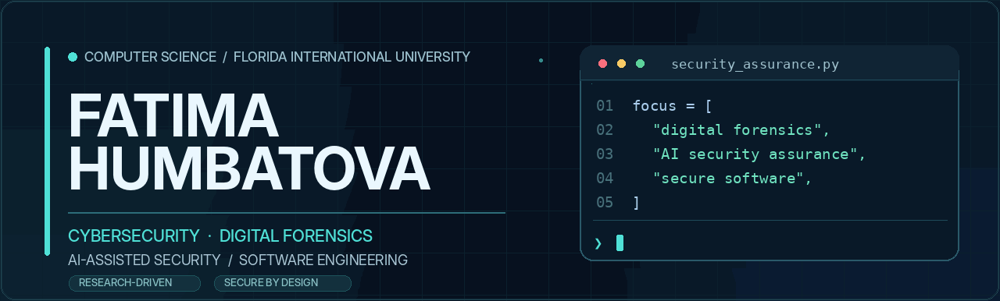

  

  
  
  

### About

I am a **B.S. Computer Science student at Florida International University (FIU)**, interested in the intersection of **cybersecurity, digital forensics, artificial intelligence, and software engineering**.

I enjoy moving from a research question to a working system: defining the problem, making design choices explicit, implementing carefully, and validating results. My current interests include **digital evidence integrity**, **AI-assisted security assurance**, and **defensible security tooling**.

- **Research experience:** Team project investigating AI-assisted completeness and consistency analysis for security requirements in critical infrastructure.
- **Recognition:** My team received a Defender-category award at **U.S. Cyber Command's Cyber RECon 2026**.
- **Campus involvement:** STARS Course Assistant at FIU; contributor to collaborative academic and software projects.

### Selected Work

<table>
  <tr>
    <th align="left">Project</th>
    <th align="left">Focus</th>
    <th align="left">Status</th>
  </tr>
  <tr>
    <td><b>AI-Assisted Security Requirements Assurance</b></td>
    <td>Security requirements, assurance gaps, AI-assisted analysis; team competition project</td>
    <td>Research / competition</td>
  </tr>
  <tr>
    <td><b>Digital Evidence Integrity & Timeline Analyzer</b></td>
    <td>File hashing, evidence preservation, metadata and forensic timelines</td>
    <td>In development</td>
  </tr>
  <tr>
    <td><b>IndieHub</b></td>
    <td>Structured game testing, bug reporting and tester hardware profiles</td>
    <td>Team project · In progress</td>
  </tr>
  <tr>
    <td><b>Student Task Manager</b></td>
    <td>Flask application for task tracking and JSON-backed persistence</td>
    <td>Completed project</td>
  </tr>
</table>

**Explore the code:** [All repositories →](https://github.com/fatyagum-lgtm?tab=repositories)

### Technical Toolkit

**Languages**

**Tools & development**

### Research Interests

- **Security assurance:** Systematic reasoning about whether requirements are complete, consistent, and verifiable.
- **Digital forensics:** Evidence integrity, reproducible workflows, forensic timelines, and careful documentation.
- **AI for security:** Evaluating where machine learning can assist analysts without replacing human judgment.

---

  Building thoughtfully. Testing rigorously. Documenting clearly.

<!-- MAINTENANCE NOTES:
- When the Digital Evidence project is published, add its real repository URL to the project name.
- Add precise URLs for the AI assurance project, Student Task Manager, and IndieHub if public.
- Once a portfolio website is live, add a portfolio badge next to LinkedIn.
- Keep project status labels and technical claims aligned with actual work.
-->
